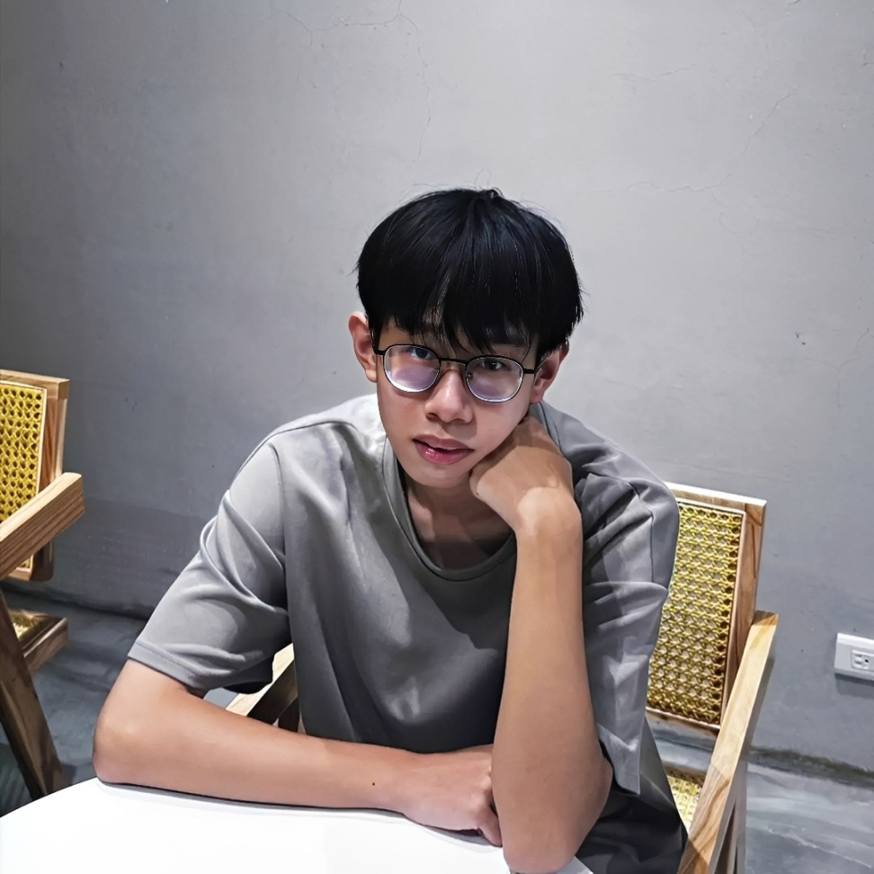
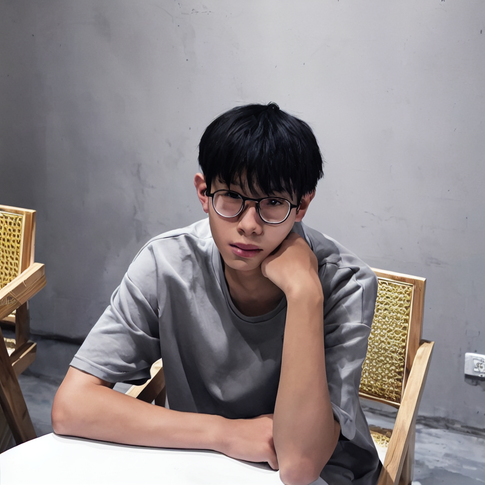
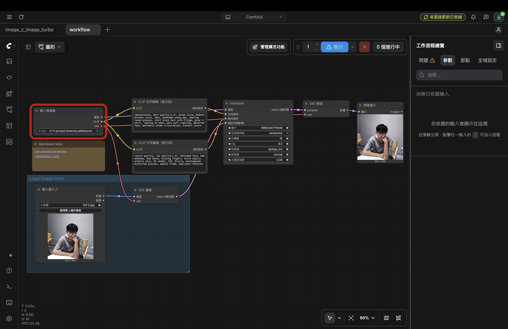
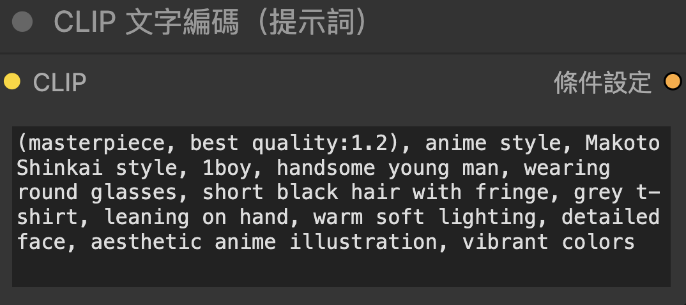
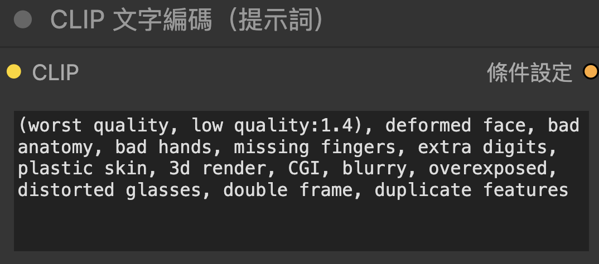

# ComfyUI 圖生圖

# 原圖

# 生成的圖

# 完整工作流截圖

# 正反提示詞

## 正面提示詞
(masterpiece, best quality:1.2), anime style, Makoto Shinkai style, 1boy, handsome young man, wearing round glasses, short black hair with fringe, grey t-shirt, leaning on hand, warm soft lighting, detailed face, aesthetic anime illustration, vibrant colors

## 負面提示詞
(worst quality, low quality:1.4), deformed face, bad anatomy, bad hands, missing fingers, extra digits, plastic skin, 3d render, CGI, blurry, overexposed, distorted glasses, double frame, duplicate features

# 5.個人心得

這次實作讓我實際動手摸索了ComfyUI的操作，整體的體驗我覺得非常有趣。一開始面對滿畫面的節點和線條覺得有點複雜，不小心開錯了放大工作流程、遇到模型缺少或圖片沒上傳的錯誤。但透過一步步排解錯誤，我慢慢熟悉了ComfyUI獨特的節點邏輯與模型擺放位置。

在圖生圖部分，我上傳了自己的照片，練習撰寫正面與負面提示詞。我發現正面提示詞可以很具體地決定畫面的風格與光影質感，而負面提示詞則能有效避開變形或塑膠感。最讓我印象深刻的是調整去雜訊強度，這個參數我把它設定在0.30時，既能保留我原本的臉部特徵，又能讓 AI 幫忙優化整體的細節與光影表現。

這次實作不僅讓我搞懂了基礎的圖生圖流程概念，也體會到這種視覺化、模組化工具的強大與靈活性，讓我對後續的AI創作打下了很不錯的基礎。